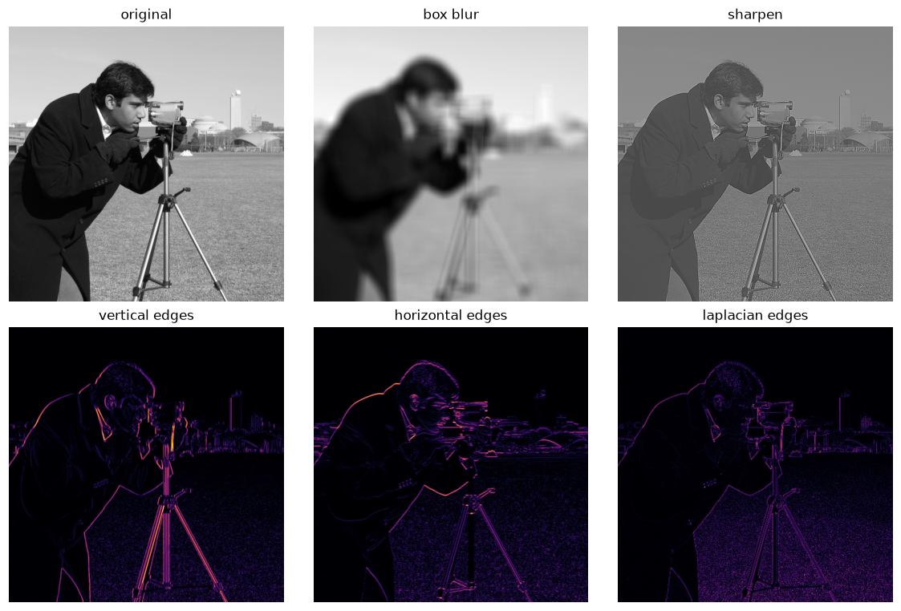
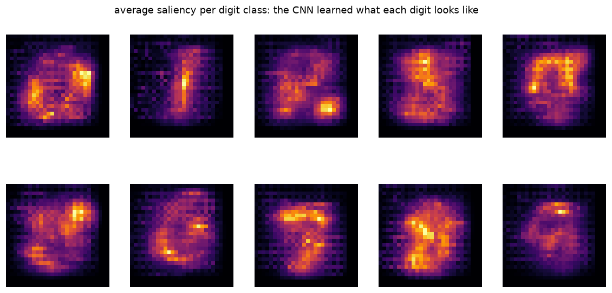
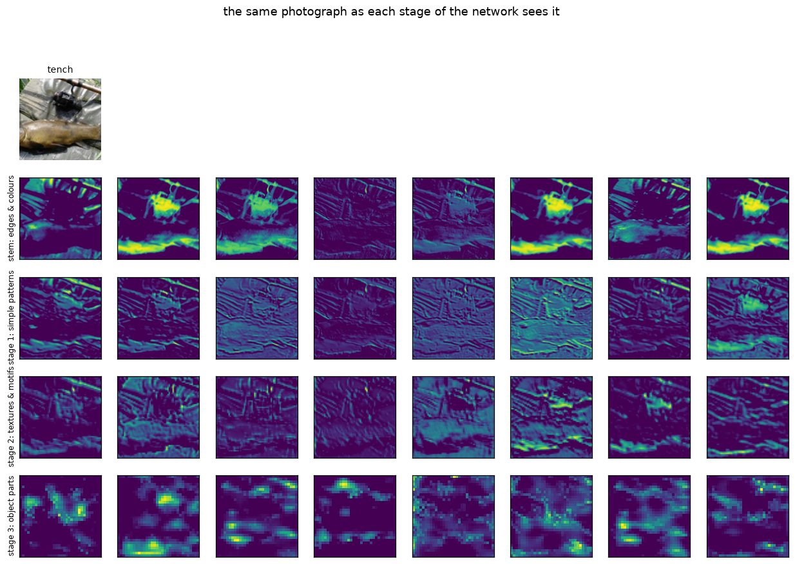
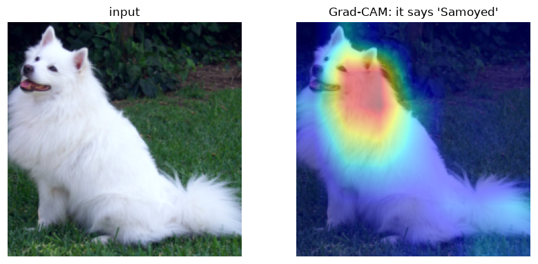

# Intro to CNNs

This is for the workshop on CNNs. The notebooks outline 4 different topics which all feed into understanding CNNs.

## Sample outputs

Left to right, top to bottom: hand-designed kernels from notebook 2, the average saliency per digit class from notebook 3, what each stage of the Imagenette net sees from notebook 4, and Grad-CAM on a pretrained ResNet50 from notebook 3.

| | |
|---|---|
|  |  |
|  |  |

## The notebooks

- `01_feedforward_neural_networks.ipynb`: trains an FNN on MNIST (about 98% test accuracy), then uses saliency maps and a scrambled-pixel test to show it never used the image's 2D structure.
- `02_convolutions_in_numpy.ipynb`: convolution written from scratch in NumPy. Classic kernels, kernel size against feature scale, and a patch cut from the image used as its own pattern matcher.
- `03_convolutional_neural_networks.ipynb`: a small CNN on MNIST with the Part 1 experiments repeated, the degradation problem and its fix in skip connections, and a pretrained ResNet50 asked what it is looking at (Grad-CAM).
- `04_cnn_on_imagnette.ipynb`: the same ideas on real photographs, using Imagenette. A naive CNN against a ResNet-20, data augmentation, a confusion matrix, and a look inside the trained net: learned stem filters, feature maps at each stage, and raw pixel space compared with learned feature space.

## Setup

Python 3 with torch, torchvision, numpy, matplotlib, pillow, and scikit-image (notebook 2 only):

```
pip install torch torchvision numpy matplotlib pillow scikit-image
```

Datasets land in `data/` automatically on first run: MNIST is about 64 MB and Imagenette-160 about 100 MB. Each notebook picks cuda, mps, or cpu depending on what your machine offers. `images/dog.jpg` is the photo used in notebook 3.
